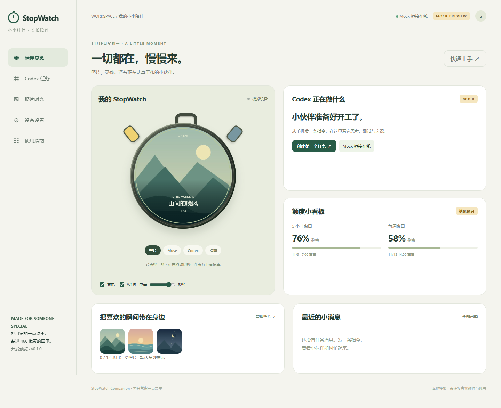

# StopWatch · 小小挂件，长期陪伴

基于 M5Stack StopWatch C152 和官方 Muse SDK，在 v0.1 上扩展签名 OTA、自动发布、在线演示及 Windows 后台交付。当前版本 **0.2.0**。

**实机进展：** 原厂完整备份及首次烧录已通过，照片/触屏/按键经本人确认；照片API经USB到真实显示、真实Codex状态和SDK离线音频已实测。手机无线、本人Muse授权、Windows正式安装与生产OTA仍待配置。见 [HARDWARE_TEST.md](HARDWARE_TEST.md)。

**[打开在线隔离演示](https://lezebomb.github.io/stopwatch/)**：无需下载仓库、运行 Node 或安装 APK。发布状态以 GitHub Actions 为准。演示任务、配对和更新均为 Mock，图片仅在浏览器内存处理；不连接真实 Codex，不具备公网执行权限。



## 日常使用与当前边界

- 挂件进入上次照片封面，保留 Wi-Fi、Muse 授权和配置。充电联网且空闲时更新；电池照片页不为更新唤醒 Wi-Fi。
- 正式手机入口是维护者的固定 HTTPS 域名，一次扫码配对，保护会话滚动续期。Edge / Chrome，无需 APK。公开演示不是正式控制台。
- Windows 正式包自带 Node，一次图形安装、选择工作区并授权，之后后台启动、主动 WSS、恢复和更新，无需每次 CMD。
- 授权失效会明确提示重新授权；仅恢复桥接自己创建的 App Server 会话，不接管 Desktop。

**正式启用还需要维护者一次性生产公钥/签名 secret、域名/中转配置和实机验收。本轮未部署 VPS，未安装本机自启动。**

## 自动交付

main push → Windows 测试 + ESP-IDF v6.0.3 构建 → 成功后部署 Pages 隔离演示。

同一提交通过 `main` CI 后，推送与 `release/config.json` 匹配的附注标签 `vX.Y.Z`。Actions 在草稿中备齐固件、Miao、Windows 桥接和门户，验签及核对上传后一次发布。正式域名和签名配置完成后，设备、Windows 和门户各自验证并拉取新版。公开 Pages 继续提供隔离演示。[交付配置](docs/DELIVERY.md)。

## OTA 与数据保留

使用官方 Bootloader 与 `esp_ota_begin/write/end/set_boot_partition`。先验证 RSA-3072/PSS-SHA256 清单与兼容性，再 HTTPS 流式写备用 4MiB 槽，核对完整字节数/SHA256，调用 ESP-IDF 镜像签名验证及镜像版本检查后才切槽。

新启动通过存储/照片、UI 心跳、服务任务与内存检查才确认；失败回滚，失败版本隔离，下载错误退避。默认每6小时检查，重连限频30分钟，网络稳定60秒、空闲30秒、电量至少40%、无通话/Codex交互才安装。设备设置新增 Software update，可查看版本/状态、手动检查，调整检查间隔及最低电量（重启生效）。

真实配置已核验 rollback 和软件签名。没有启用硬件 Secure Boot、Flash/NVS eFuse 密钥生成或 eFuse anti-rollback。分区布局保持双4MiB应用与 `0x822000 / 7MiB` 照片分区。**默认 flash_args 不含 photos.bin，OTA不写照片、NVS、授权、Bootloader或分区表。**

独立系统资源有签名清单、逐文件校验、写时复制、原子指针和恢复实现。空间不足推迟而不擦旧数据。系统资源事务在中转侧单独管理。私人相册使用下方的挂件同步通道。

## 开发者本地调试

`Start-StopWatch.cmd`仅为开发工具，不是最终交付入口。

```powershell
cd D:\stopwatch
npm.cmd ci
npm.cmd run build
npm.cmd start
npm.cmd run build:preview
npm.cmd run mock:updates
npm.cmd run package:windows
```

本地服务只绑定127.0.0.1:8787；打开输出中的两分钟配对链接，总览含466px模拟器。`node scripts/pair.mjs`生成新码。静态输出为preview-dist；HTTPS测试更新源为127.0.0.1:8790。Windows开发包阻止正式安装，打包不会注册启动。

## 构建与测试

本机工具在 `.tools` / `.deps`；新Windows准备Git、Node24、便携uv后运行 `scripts/setup.ps1`。

```powershell
./scripts/build-firmware.ps1
./scripts/build-firmware.ps1 -FactoryAssets # 仅首次初始化
./scripts/build-firmware.ps1 -Realtime
./scripts/build-firmware.ps1 -Release       # 须配置正式信任根和私钥路径
npm.cmd test
npm.cmd run test:browser
npm.cmd run build:preview
npm.cmd run test:preview
npm.cmd run protocol:check
npm.cmd audit
```

应用在 `artifacts/stopwatch.bin`，完整构建在 `firmware/build`，脚本不刷写。首次交付应安装正式信任根和rollback Bootloader；不能假定公开开发密钥的v0.1能自动成为安全生产设备。

21项测试覆盖C更新事务、HTTPS、签名篡改、断网、双槽模拟/回滚、数据保留、Windows损坏恢复、生产隔离、工作区/审批；Edge覆盖桌面/移动和静态零API/WS请求。软件故障注入不等于实物断电测试。

## 工程入口

| 路径 | 内容 |
|---|---|
| firmware/companion/sw_updater.* | ESP更新、验签、回滚、健康检查 |
| firmware/companion/sw_update_core.* | 可主机运行的策略与OTA操作顺序 |
| updates/ | 清单、HTTPS Mock、资源事务/故障模型 |
| windows/、bridge/real-engine.mjs | 后台、更新、图形安装、授权会话 |
| server/、web/ | 中转与控制台，演示/生产隔离 |
| .github/workflows/、release/ | CI、Pages、稳定发布配置 |

实际结果：[PROGRESS.md](PROGRESS.md)。实机：[HARDWARE_TEST.md](HARDWARE_TEST.md)。安全：[SECURITY.md](SECURITY.md)。上游/许可：[docs/UPSTREAM.md](docs/UPSTREAM.md)、[THIRD_PARTY_NOTICES.md](THIRD_PARTY_NOTICES.md)。私人照片、Token、私钥和运行数据不进仓库。

## 手机扫码配网

挂件照片页左上角「手机配网」显示二维码，用 Android Chrome 打开 [蓝牙配网页](https://lezebomb.github.io/stopwatch/setup/)，选择 MuseGadget 并输入挂件显示的六位配对码，然后在手机输入已有 Wi-Fi 或手机热点的名称、密码。无需电脑或 APK；网络由官方 Muse SDK 保存（最多8个）并按范围自动重连。手机热点可以保持开启，必须兼容2.4GHz。手机网页不能替设备连接5GHz热点。

本页仅做本地加密蓝牙配网，与 Pages Mock 控制台分离；不上传/持久保存密码，没有任务执行或账号授权入口。需要支持 Web Bluetooth 的浏览器；优先 Android Chrome，Edge按功能检测提示。进入配网页临时开启挂件端手机配网蓝牙并保持唤醒，返回、5分钟到期或重启即结束。照片页尊重用户的 Wi-Fi 开关，休眠和唤醒后的重连由 Muse SDK 管理；首次 Muse 账号授权仍单独进行。真实手机 BLE 配对与联网以 HARDWARE_TEST 现场结果为准。

## 挂件无线同步

挂件先扫码连上 Wi-Fi。正式控制台的操作者进入「设置 → 绑定 StopWatch」，再打开挂件的「手机配网」，用手机在蓝牙授权页选择设备并确认。两分钟授权码只用一次，之后通过 HTTPS 自动获取相册、默认封面、轮播、边框和 Codex 摘要。设备使用独立只读授权，可在控制台撤销。离线时继续显示已存照片。

固件默认不启用中转。正式构建使用 `release/config.json` 的固定 HTTPS 来源。本地开发可在构建前设置 `SW_DEVICE_RELAY_ORIGIN`，内网自建 CA 时可另用 `SW_DEVICE_RELAY_CA` 指向公开 CA 证书。中转用 `STOPWATCH_MODE=production` 和同一 HTTPS `STOPWATCH_PUBLIC_ORIGIN`，通过受信反代访问。手机浏览器也需要信任该证书。功能代码已编译，实际无线链路待集中实机验收。

## 妙妙与显示模式

照片页低亮常显是默认模式。在手机设置可切换智能省电或续航优先，也可选择一张已上传照片作为隐藏彩蛋。隐藏照从封面和轮播中移出，照片页连点五次或到指定日期会打开。充电时封面保持常亮。

Codex 页的妙妙来自固定的 [Miao 源版本](https://github.com/lezebomb/Miao/tree/e96c93f471b9beb68b538b17b8eeecd6daa6fce4)。`node scripts/miao-assets.mjs` 生成内置动画包、网页 WebP 和布局摘要。正式设备可独立验证并切换兼容的签名 Miao 包，离线或外部包不可用时仍能播放内置动画。
